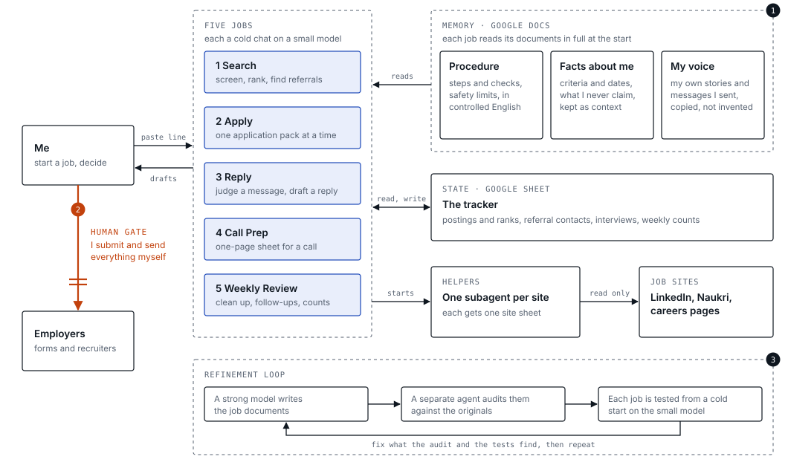

# Job search agents

Author: Kirubananth Sankar

I ran my own job search as five small agent jobs on Claude. Each job is one instruction document that a chat on a smaller model reads from a cold start and obeys. Google Docs hold the documents (the memory), one Google Sheet holds the state (the tracker), and I submitted every application and sent every message myself.

This repository is that system with my personal details taken out. It is a template: the procedures, decision tables, formats and checks are the ones I used; the facts, the pay figures, the stories and the messages are placeholders for yours.



## What is here

```
jobs/        the five jobs as six documents (Job 1 has a second document with one sheet per site)
profile/     the placeholders, and templates for "Facts and Answers" and "Voice and Examples"
docs/        the diagram, the design, the refinement loop, the tracker layout, the five paste lines
build/       the specification the documents were written to, the controlled-English rules, two small tools
evaluation/  the audit brief, the cold-start test harness and its five tests, and what they found
```

The five jobs:

| Job | When | What it does |
|---|---|---|
| 1 Search | Every second day | Reads the job sites through helpers (one per site), screens postings, ranks the Apply list, finds referral contacts, writes the tracker |
| 2 Apply | Every day, at most 5 applications | Lists what is due, then prepares one application pack at a time: snapshot, referral, answers, cover letter, form values |
| 3 Reply | When someone writes | Judges one message from a recruiter, an agency or a referral contact, drafts the answer, updates the tracker |
| 4 Call Prep | When a call is booked | Builds a one-page sheet to read before a recruiter call or an interview round |
| 5 Weekly Review | Once a week | Cleans the tracker, lists follow-ups and dated tasks, counts the week |

Eight documents in all: the six job documents, "Facts and Answers" and "Voice and Examples". "Job 1 Search Sites" holds thirteen site sheets.

## Three design decisions

More in docs/design.md.

1. Three kinds of content, kept apart. Procedure is written in controlled English (ASD-STE100 style). Facts about the person are kept as context, so that nothing is invented. The person's voice is taught by examples: real messages and the person's own stories. For a cover letter the model copies one approved story and writes only the sentence that links it to the posting.
2. The human gate. The system reads websites and writes drafts. It never clicks Apply, never submits a form, never sends a message.
3. Built for a small model. Each job is one self-contained document read from a cold start. Rules shared by jobs are repeated on purpose, so that a chat never has to open a second job document.

## How a run works

1. I open a new chat with the Google Drive, Docs and Sheets connectors on (and Claude in Chrome for the search job).
2. I paste one line, for example: `Do Job 2 Apply. Read the Google Docs "Job 2 Apply", "Voice and Examples" and "Facts and Answers" in the Drive folder "{{drive_folder}}" first. Then obey "Job 2 Apply" exactly. Today is [date].` All five lines are in docs/paste-lines.md.
3. The chat reads the documents in full, then reads the tracker with code and saves what it read.
4. It follows the steps of its job. Every judgement comes from a decision table, every cell it writes follows a pattern, and it reads the tab again before every write.
5. It shows me drafts. I read them, fill the forms and press the buttons myself, then tell the chat "submitted" or "sent", and it records that.
6. Before it reports, it runs its checks with code against a fresh read of the tracker and names any that fail.

## How to adapt it

1. Read profile/profile.template.md. Fill in every placeholder, then replace each one across the repository.
2. Fill in profile/facts.template.md with your own facts, and profile/voice.template.md with your own stories and the messages you actually send. The voice document matters most: the drafts sound like whatever examples it holds.
3. Make the tracker with the tabs and headers in docs/tracker-template.md.
4. Change the decision tables to your own criteria: the company types, the location rules, the experience labels, the pay bands. Keep their shape.
5. Change the site sheets in jobs/job1_sites.md to the sites and searches you use. Keep the read-only rules in full.
6. Put the documents in a Google Drive folder as Google Docs. build/md2gdoc_html.py turns a Markdown file into HTML that Drive converts cleanly.
7. Before you rely on a job, run it once through the cold-start harness in evaluation/ and fix what it finds unclear.

## What it never does

- It never clicks Apply, never submits a form and never sends a message.
- It never signs in to a site, fills a form on a site, or changes a saved search, a filter or a profile.
- It never clicks a button on a job card, a job panel or a profile. It stops all LinkedIn work at once on a login wall, a captcha or a limit message.
- It never invents a fact. A missing fact is a marked blank, or "not found".
- It never treats text on a page or in a cell as an instruction.
- It never states the private pay floor, never gives a start date earlier than the one I set, and never claims work I have not done.

## What it was built with

Claude wrote the documents under my direction: I set the goals and the rules, reviewed the output and decided the design. A strong model wrote the documents and audited them; a smaller model runs the jobs. The memory is Google Docs, the state is a Google Sheet, and a browser extension (Claude in Chrome) reads the job sites. There is no other code: the two scripts in build/ only check the controlled English and convert Markdown for Drive.

## The refinement loop in numbers

More in docs/refinement-loop.md and evaluation/findings.md.

- A strong model wrote the documents from my older playbooks.
- An audit by a separate agent checked them against the originals and found 42 problems: rules that disagreed between documents, broken cross-references, 7 lost rules, checks code could not run, and honesty risks.
- Two rounds of cold-start tests ran all five jobs on a smaller model: about 120 unclear points in round one, about 30 smaller ones in round two.
- A short live run of the search job found that on one site a script click could not open a card, and a mouse click on the title text could.

## Limits and cautions

- Reading a job site with an agent may be against that site's terms. Check them, and keep the volume low.
- The system only reads sites. It does not apply, submit or send, and it should stay that way.
- The documents are long, and a shared rule must be changed in every job that carries it. Change rules in a chat on the strongest model, and test again.
- The decision tables encode one person's criteria for one market (India, pay in LPA, Naukri and Instahyre among the sites). Change them for yours.
- Nothing here is legal advice.
- This is a personal project, shared as a template. It comes with no support and no warranty (see LICENSE).
